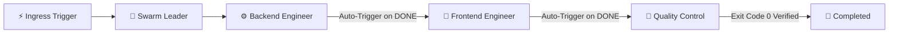

# ⚡ Flowork OS — Swarm Flow Orchestration Engine

> **Module Directory**: `swarmflow/`  
> **Sovereign Principles**: 1 Preset = 1 Atomic JSON File, Multi-OS Agnostic (Zero-Hardcode Paths), Boundless Multi-Domain Intelligence.

---

## 1. What is Swarm Flow?

**Swarm Flow** is the autonomous multi-agent swarm orchestration engine built on Directed Acyclic Graph (DAG) architecture within Flowork OS.

### 🌐 Universal Multi-Domain Intelligence (Beyond Code)
Flowork OS rejects the narrow assumption that AI multi-agent swarms are strictly for software engineering. Swarm Flow is designed from first principles as an **All-Domain Autonomous Framework**:
- **📈 Forex & Quant Finance**: Real-time FX market tick sensor, Quantitative VaR calculation, Capital Preservation Risk Manager audits, and Autonomous Order Dispatching.
- **⚖️ Corporate Law & Contract Auditing**: Automated clause scrutiny, hidden liability and indemnity detection, counter-redline generation, and Senior Partner sign-off.
- **🧠 Psychology & CBT Consultation**: Empathetic client triage and intake, cognitive reframing coaching, somatic homework management, and immediate crisis de-escalation routing.
- **🚀 SEO & Growth Marketing**: Autonomous Chrono SERP rank auditing, high-intent keyword gap analysis, EEAT content writing, and Conversion Rate Optimization (CRO).
- **🎬 Creative Media & YouTube**: Viral trend intelligence, competitor retention analysis, high-CTR hook generation, multi-track audio mixing, and automated video asset rendering.
- **💻 Software Systems & Coding**: Architecture coordination by the Leader, resilient API and database implementation by Backend, responsive glassmorphic UI by Frontend, penetration auditing by Security, and rigorous regression testing by Quality Control.

---

## 2. Storage Architecture (1 Preset = 1 Atomic JSON File)

All presets reside inside the `swarmflow/` directory, dynamically resolved by the native Rust kernel (`resolve_engine_root().join("swarmflow")`). **Hardcoding host absolute paths (such as `/home/...` or `C:\...`) is strictly prohibited** to ensure flawless multi-OS portability across Linux, macOS, and Windows.

### Directory Topology:
```text
swarmflow/
├── active.json          <-- Pointer file identifying the currently active preset
├── trading.json         <-- Forex & Quant Trading Preset
├── coding.json          <-- Software Systems & Coding Preset
├── seo.json             <-- Marketing & Growth SEO Preset
├── legal.json           <-- Corporate Law & Contract Audit Preset
├── psychology.json      <-- Psychology & CBT Consultation Preset
├── media.json           <-- Creative Media & YouTube Preset
└── [custom_preset].json <-- Any user-defined custom domain preset
```

### Format of `active.json`:
Tracks the active preset ID and modification timestamp:
```json
{
  "activePresetId": "coding",
  "updatedAt": 1740000000000
}
```

---

## 3. Preset File Anatomy (`{preset_id}.json`)

Every preset is an atomic, self-contained JSON file containing canvas positioning metadata, nodes, and directed cable connections:

```json
{
  "id": "trading",
  "name": "Forex & Quant Trading",
  "icon": "📈",
  "domain": "Forex / Quant Finance",
  "description": "Real-time FX tick sensor, Quant VaR modeling, Capital Preservation Risk Manager, and Autonomous Order Dispatcher.",
  "panX": 40,
  "panY": 40,
  "scale": 1.0,
  "nodes": [
    {
      "id": "node-fx-sensor",
      "type": "trigger",
      "triggerId": "market_tick_sensor",
      "name": "Forex Market Volatility Sensor",
      "role": "Forex / Crypto Market Sensor",
      "icon": "📈",
      "x": 100,
      "y": 200,
      "triggerConfig": {
        "ingressType": "market_tick",
        "symbol": "EURUSD, XAUUSD, BTCUSDT",
        "conditionExpr": "payload.spread <= 1.2 && payload.rsi < 30"
      }
    },
    {
      "id": "node-fx-quant",
      "type": "agent",
      "name": "Quantitative Analyst",
      "role": "Quantitative Analyst",
      "icon": "📊",
      "x": 450,
      "y": 200,
      "taskPrompt": "Analyze price action, volume momentum, and portfolio value-at-risk.",
      "rulePrompt": "Reject high-spread slippage anomalies and enforce statistical edge."
    }
  ],
  "connections": [
    {
      "id": "conn-fx-1",
      "from": "node-fx-sensor",
      "fromPort": "out-1",
      "to": "node-fx-quant",
      "guardianEnabled": true
    }
  ]
}
```

### Core Components:
1. **Trigger Node (`type: "trigger"`)**: Ingress gateway capturing external events (Webhook, Market Tick, Cron Scheduler, File Watcher, Client Intake).
2. **Agent Node (`type: "agent"` or `"leader"`)**: Autonomous specialist holding an identity, `taskPrompt` directive, and `rulePrompt` constraints.
3. **Connections**: Directed cables defining artifact and task handovers between upstream and downstream nodes, guarded by validation gates (`guardianEnabled`).

---

## 4. How Swarm Flow Works (Autonomous Sequential Relay)

Swarm Flow executes tasks through an autonomous, uninterrupted relay chain:



1. **Ambient Preset Awareness (Native Binary Level)**:
   - When a user interacts in chat, the Rust binary reads `swarmflow/active.json` and injects the `<ACTIVE_SWARM_PIPELINE>` block into the system prompt.
   - The agent immediately recognizes the active domain, its assigned role, team members, and downstream handover rules without needing manual file reads.
2. **Autonomous Sequential Relay (Uninterrupted Multi-Agent Chain)**:
   - When an upstream specialist (e.g., Backend Engineer) finishes their task and outputs a completion signal (**DONE**), the chat turn **DOES NOT HALT**.
   - Instead, the Swarm Flow kernel automatically dispatches the task context to the connected downstream node (e.g., Frontend Engineer).
   - Once Frontend completes the interface, it triggers the verification specialist (e.g., Quality Control) to perform automated verification tests until **Exit Code 0** is achieved.
   - Each specialist operates in strict role isolation according to the active pipeline topology.
3. **3D Virtual Office Synchronization**:
   - The 3D Virtual Office reads the active preset and **renders only the avatars and desks belonging to the active preset squad**.
   - If 20 agents exist across the system, the 3D room remains clean, uncluttered, and displays only the active specialists (e.g., 4–5 agents).

---

## 5. How to Create a New Preset

### Method A: Via Visual Canvas UI
1. Navigate to the **Swarm Flow** tab in Flowork Canvas UI.
2. In the floating top-right HUD, click **➕ New**.
3. Enter a title for the new domain preset (e.g., `Crypto Arbitrage`, `SEO Content Engine`, `MQL5 Expert Advisor`).
4. Drag and drop Triggers from the left sidebar onto the canvas, followed by the required Agent Specialists.
5. Connect upstream output ports to downstream input ports using cables.
6. Double-click on any node to configure its **Task Directive** and **Rule Constraints** in the modal editor.
7. Click **💾 Save** on the Floating HUD. The system automatically writes the `{preset_id}.json` file and marks it active.

### Method B: Headless / Manual JSON File Creation
1. Create a new file inside `swarmflow/{your_preset_id}.json`.
2. Populate it with the standard JSON structure shown above.
3. Update `swarmflow/active.json` to point to your new preset ID:
   ```json
   {
     "activePresetId": "your_preset_id",
     "updatedAt": 1740000000000
   }
   ```
4. Reload or open Flowork OS; the Swarm Flow canvas and 3D Virtual Office will automatically load and render the new preset.
