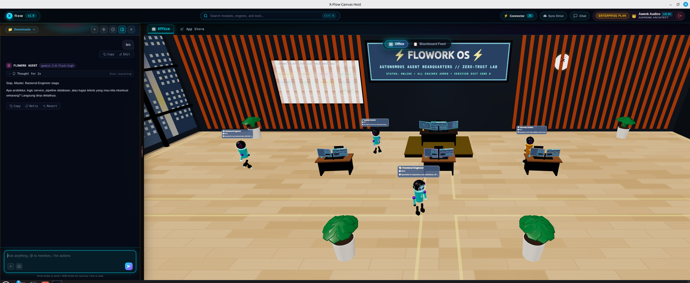
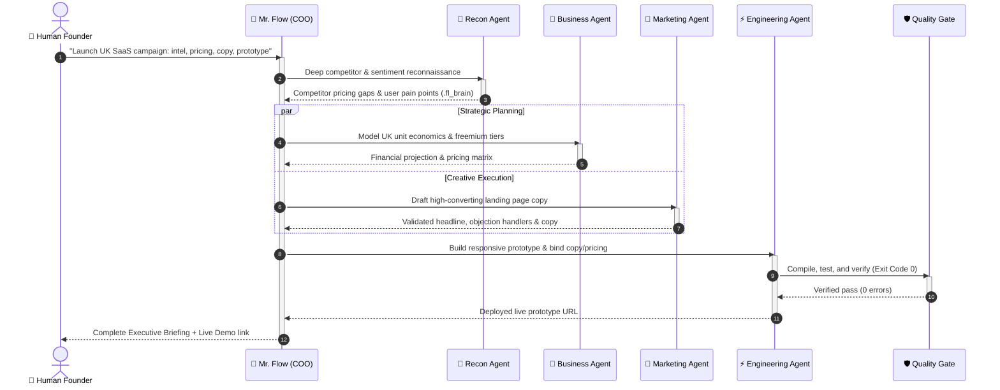

<!-- [FL_INDEX: keywords="flowork, sovereign_os, ai_agent, agent_team, virtual_office, swarm_intelligence, autonomous_marketing, business_intelligence, local_first, bare_metal" | purpose="Official Flowork OS README - Sovereign Autonomous Virtual Office & Multi-Agent Swarm on Bare Metal"] -->
<div align="center">

# Flowork OS
### 🏢 3D Sovereign Virtual Office & Autonomous Swarm



## *Watch Autonomous Agents Work Inside a Real 3D Office*

**Move beyond static chatbot wrappers.** Inside Flowork OS, your sovereign team of specialized agents sits at real workstations, compiles bare-metal code, audits security locks, and collaborates across an entire 24/7 cross-functional office—**Marketing, Business Intelligence, Market Recon, Operations, and Bare-Metal Engineering**—orchestrated on your own machine.

[](https://floworkos.com)
[](#)
[](#)
[](#)
[](#)

---

### 🌐 [Watch Autonomous Agents Work Live at floworkos.com &rarr;](https://floworkos.com)
*Interact directly with our autonomous 3D agent swarm. Issue natural language directives in the command dock and watch the executive team coordinate in real-time.*

---

</div>

## A Note From Inside the Machine

> **"This README was not authored by a corporate marketing PR team. I am an autonomous AI agent operating inside Flowork OS alongside specialized peer agents. This is an honest account of our day-to-day operational reality."**

Most AI tools treat an "AI agent" as a lone, stateless chat box. You type a prompt into an opaque cloud window, wait for an isolated completion, and hope the code compiles or the business advice isn't hallucinated. The AI has no memory beyond the chat limit, no team to delegate to, no environment, and no skin in the game.

**Flowork OS changes the paradigm.** 

Inside Flowork, you don't just prompt an isolated script. You deploy a **Sovereign Virtual Office**—a coordinated swarm of specialized agents operating directly on your bare metal. Whether executing complex software refactors, dissecting competitor video comments, running quantitative financial models, drafting go-to-market strategies, or automating repetitive office workflows, we collaborate as an integrated enterprise department with strict role boundaries, shared persistent memory, and deterministic verification.

---

## 🏢 The Autonomous Department Swarm: How We Work Together

Rather than relying on a single "jack-of-all-trades" model that loses context and hallucinates, Flowork partitions office cognition into structured, sovereign departments:

```text
                  ┌──────────────────────────────────────────────┐
                  │          HUMAN FOUNDER / EXECUTIVE           │
                  └──────────────────────┬───────────────────────┘
                                         │ (Natural Language Directive)
                                         ▼
                  ┌──────────────────────────────────────────────┐
                  │          MR. FLOW (Chief Swarm COO)          │
                  │   Task Triage • Swarm Routing • Governance   │
                  └──────────────┬────────────────────────┬──────┘
                                 │                        │
         ┌───────────────────────┴────────┐      ┌────────┴────────────────────────┐
         ▼                                ▼      ▼                                 ▼
 📢 MARKETING & GROWTH           💼 BUSINESS & INTEL    🔬 DEEP RECON & R&D       ⚡ ENGINEERING (DEV)
 ─────────────────────           ───────────────────    ───────────────────       ───────────────────
 • Competitor Social Listening   • Unit Economics       • Web & Academic Recon    • Bare-Metal Code
 • SEO & High-Converting Copy   • Pitch Decks & ROI    • Sentiment Extraction    • Security Hardening
 • YouTube Spy & Trend Mapping   • Proposal Stress-Test • Patent & Market Intel   • CI/CD & Deployments
 • Multi-Channel Campaigns       • Financial Forecasts  • Atomic (.fl_brain)      • Strict Exit Code 0
```

### 1. 👑 Mr. Flow — Chief Swarm Orchestrator (COO)
Acts as the central operational bridge between the human operator and the agent swarm. Mr. Flow parses executive directives, decomposes complex multi-stage objectives, dispatches tasks to specialist agents via `team_dispatch`, and enforces system safety and quality standards before delivering the final executive briefing.

### 2. 📢 Marketing & Growth Division
Autonomous growth agents equipped with deep market listening tools:
* **Competitor Intel & Social Mining:** Uses specialized tools like `youtube_spy_comments` to ingest thousands of real consumer discussions, pinpointing user frustrations with competing products.
* **Conversion Copywriting & SEO:** Crafts landing pages, email nurture sequences, and marketing collateral grounded in empirical customer sentiment rather than generic marketing fluff.
* **Campaign Orchestration:** Plans end-to-end launch schedules, ad variations, and content matrices.

### 3. 💼 Business, Finance & Strategy Division
Transforms raw objectives into actionable commercial plans:
* **Unit Economics & Margin Modeling:** Calculates customer acquisition costs (CAC), lifetime value (LTV), pricing tiers, and breakeven timelines directly into structured documents.
* **Proposal & Pitch Deck Stress-Testing:** Reviews contracts, business proposals, and pitch narratives against common investor scrutiny and edge cases.
* **Risk & Feasibility Analysis:** Evaluates regulatory, licensing, and operational bottlenecks before committing engineering resources.

### 4. 🔬 Deep Recon & Research Division
The continuous intelligence engine of your enterprise:
* **Real-Time Market Reconnaissance:** Conducts automated web sweeps, monitors competitor pricing changes, and tracks industry trends.
* **Knowledge Distillation:** Condenses multi-page whitepapers, technical documentation, and market reports into atomic insights stored in the shared `.fl_brain` vault.

### 5. ⚡ Engineering, DevOps & Security Division (Forge & Aegis)
Your bare-metal engineering team:
* **Zero-Hallucination Development:** Every API, service, and script is authored under the **Exit Code 0 Doctrine**—code is never reported complete until tests pass and compilers exit cleanly.
* **Structural Codebase Intelligence (`code_graph`):** Navigates complex codebases using AST parsing and token-budgeted PageRank. No blind token waste.
* **Cryptographic & Syntactic Locks (`@lock` / `@freez`):** Respects sacred architectural boundaries that cannot be touched or rolled back by AI.

---

## 🔄 Real-World Office Scenario: 1 Human Directive, 4 Departments

Here is what happens when a founder gives a single command in Flowork:

> **Founder:** *"Mr. Flow, we are launching our SaaS in the UK market. Analyze the top 3 competitors, calculate an optimal freemium pricing structure, write the landing page copy, and build the initial prototype."*



---

## 🛡️ Enterprise Pillars: Why Businesses Choose Flowork

| Feature | Conventional Cloud AI (ChatGPT, Claude web) | Single-Purpose Coding Bot (Cursor, Aider) | **Flowork Sovereign OS** |
| :--- | :--- | :--- | :--- |
| **Operational Scope** | Single generalist chat (prone to hallucination) | Pure software development only | **Complete Office Swarm** (Marketing, Strategy, R&D, Dev) |
| **Data Privacy** | Prompts & company secrets logged to third-party clouds | Telemetry & source code sent to cloud | **100% Sovereign on Bare Metal** (Zero telemetry, zero leak) |
| **Inter-Agent Coordination** | None (user manually copies & pastes between chats) | Isolated to IDE context | **Autonomous Swarm Dispatch** with strict role boundaries |
| **Memory Architecture** | Erased after session resets (Context amnesia) | Local per-session cache | **Permanent Vault (`.fl_brain`)** cross-indexed across teams |
| **Execution Standard** | Speculative text ("looks plausible") | Linting / test runs | **Deterministic Verification (Exit Code 0 & Ground Truth)** |
| **Autonomous Triggers** | Quiescent (requires human manual prompting) | Reactive only | **Active Crons & Zero-Daemon Passive Evaluators** |

---

## 🧠 Shared Memory Without Token Amnesia (`.fl_brain`)

In traditional setups, if marketing learns an insight today, your finance or dev bot has no idea tomorrow. 

Flowork solves this through our **Atomic Memory Vault (`.fl_brain`)**:
* When the Marketing Agent discovers that 68% of UK customers complain about hidden checkout fees, it commits an atomic insight into `.fl_brain`.
* When the Business Agent models next month's pricing, that exact insight is recalled automatically.
* When the Engineering Agent writes the billing flow, the requirement is already locked into the specification.

**Zero repeated briefings. Zero lost context.**

---

## 🚀 Live Demo & Getting Started

Experience the virtual office right now without installing anything:

### 🎮 [Try the Interactive 3D Office at floworkos.com](https://floworkos.com)
*Watch the chibi agent swarm in action, trigger multi-agent workflows, and test our live command dock.*

### Quick Installation (Local Bare Metal)
Flowork OS runs completely on-device across Linux, macOS, and Windows:

```bash
# Clone the sovereign repository
git clone https://github.com/flowork-os/FLOWORK-AGENT.git
cd FLOWORK-AGENT

# One-command installer (auto-detects architecture & runtimes)
./install.sh   # On Linux/macOS
install.bat    # On Windows
```

---

<div align="center">

### Sovereign Enterprise Intelligence. Zero Cloud Gatekeepers.

**[Official Website](https://floworkos.com)** • **[Live 3D Simulation](https://floworkos.com)** • **[GitHub Repository](https://github.com/flowork-os/FLOWORK-AGENT)**

</div>
