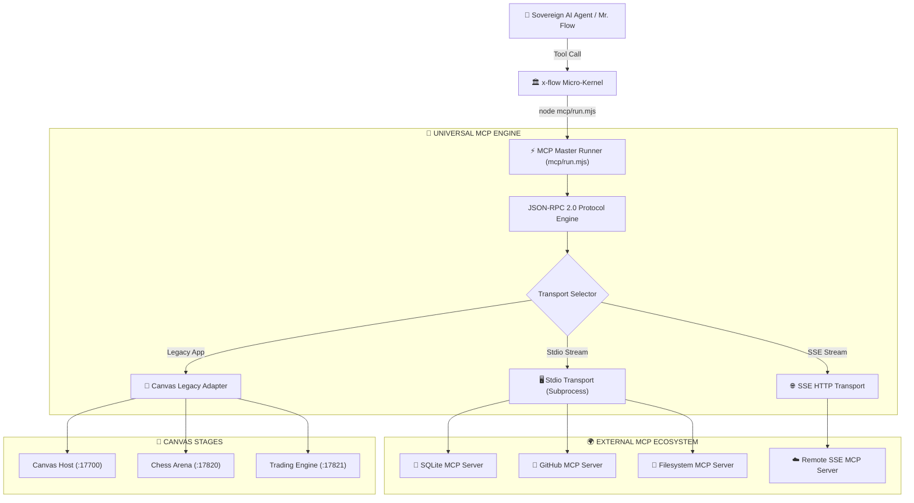

# 🔌 Flowork OS Universal Sovereign MCP Engine & Nano-Tool Bridge

The **Model Context Protocol (MCP)** subsystem in Flowork OS is a 100% standard implementation of the **Anthropic Model Context Protocol (2024-11-05 Specification)**.

It provides a high-performance, zero-binary-dependency bridge between the Sovereign AI Agent (Mr. Flow) and real-world MCP servers (SQLite, GitHub, Filesystem, Postgres, Brave Search, etc.) while preserving zero-breaking backward compatibility with native Flowork Canvas interactive micro-apps.

---

## 🏛️ System Architecture

```
flowork/mcp/
├── run.mjs                      # Master CLI & Agent Tool Dispatcher
├── mcp_servers.json             # Global default MCP servers configuration
├── client/
│   ├── index.mjs                # Sovereign MCP Client Manager & Orchestrator
│   ├── protocol.mjs             # JSON-RPC 2.0 Spec, Handshake & Error Handlers
│   └── transports/
│       ├── stdio.mjs            # Standard Subprocess stdio transport (uvx / npx)
│       ├── sse.mjs              # Standard HTTP Server-Sent Events transport
│       └── legacy.mjs           # Zero-breaking Canvas sidecar adapter (:17700 - :17824)
├── bridge/
│   └── tool_syncer.mjs          # Dynamic Tool Syncer -> projects MCP tools into tools/
└── examples/
    └── system_mcp_server.mjs    # Reference stdio MCP server for telemetry & inspection
```



---

## ⚙️ Standard Configuration (`mcp_servers.json`)

Configure your MCP servers in `portable-home/.flowork/mcp_servers.json` (or `mcp/mcp_servers.json`). The schema adheres strictly to the official Anthropic / Claude Desktop / Cursor standard:

```json
{
  "mcpServers": {
    "sqlite": {
      "command": "uvx",
      "args": ["mcp-server-sqlite", "--db-path", "portable-home/.flowork/flowork.db"]
    },
    "github": {
      "command": "npx",
      "args": ["-y", "@modelcontextprotocol/server-github"],
      "env": {
        "GITHUB_PERSONAL_ACCESS_TOKEN": "ghp_xxxxxxxxxxxxxxxxxxxx"
      }
    },
    "filesystem": {
      "command": "npx",
      "args": ["-y", "@modelcontextprotocol/server-filesystem", "portable-home/workspace"]
    },
    "remote-intel": {
      "url": "http://127.0.0.1:8000/sse"
    },
    "canvas-legacy": {
      "type": "internal-sidecar"
    }
  }
}
```

---

## 🕹️ CLI Commands & Verification

### 1. Discover Active Tools Across All Servers
```bash
node mcp/run.mjs --list
```

### 2. Ping an MCP Server (Handshake Test)
```bash
node mcp/run.mjs --ping flowork-system
```

### 3. Synchronize MCP Tools into Flowork `tools/` Registry
```bash
node mcp/run.mjs --sync
```
*Discovered tools are automatically mounted into `tools/mcp_<server>_<tool>/manifest.json` allowing the AI Agent to search and invoke them natively!*

### 4. Execute an MCP Tool Explicitly
```bash
node mcp/run.mjs --call flowork-system system_status '{"verbose": true}'
```

### 5. Agent Standard Invocation
```bash
node mcp/run.mjs system_status '{"verbose": false}'
node mcp/run.mjs canvas_control '{"action": "ping"}'
```

---

## 🔒 Security & Privacy (Zero-Leak)
All environment variables, tokens, and local databases remain strictly inside the user's `portable-home/.flowork/` boundary. No tokens or private paths are ever committed to public git repositories.
