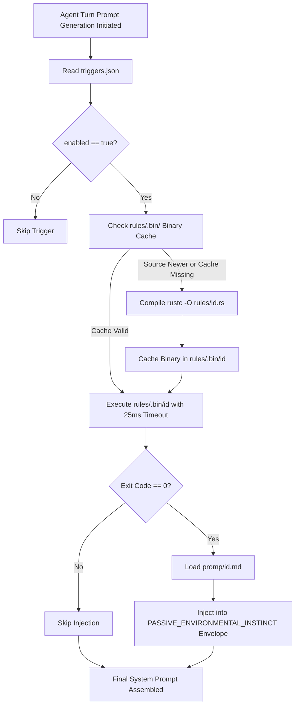

# 🏛️ Passive System Trigger Standard & Architecture Runbook

## 1. Overview & Architectural Philosophy
A **Passive Trigger** is an ambient sensory evaluator that is automatically discovered, compiled, and evaluated by the Flowork OS engine.

### The "Passive" Nature
Unlike Active Triggers (which run persistent background daemons and proactively wake up agents via canvas links), Passive Triggers are **quiescent (zero daemon overhead)**:
* **Evaluation on Turn Assembly**: The native engine evaluates passive triggers Just-In-Time (JIT) exclusively when an agent prompt turn is being synthesized.
* **Ambient Instinct**: When a trigger's condition is met, its prompt payload is dynamically injected into the agent's `<PASSIVE_ENVIRONMENTAL_INSTINCT>` container.
* **Extensibility**: All triggers live externally under `system/system_promp/`. Developers can define arbitrary environmental conditions—ranging from desktop state to system metrics—without modifying the engine.

---

## 2. The Triad Structure
Every passive trigger in Flowork OS is defined across three discrete, decoupled pillars:

```text
system/system_promp/
├── triggers.json              # [PILLAR 1: Manifest & Switch Index]
├── rules/                     # [PILLAR 2: Logic Switch Engines in Rust (.rs)]
│   ├── document_companion.rs
│   └── thermal_defense.rs
└── promp/                     # [PILLAR 3: Prompt Instruction Payloads (.md)]
    ├── document_assistant.md
    └── thermal_zombie_hunt.md
```

### Pillar 1: Declarative Switch Index (`triggers.json`)
The central registry listing trigger metadata, active switches (`enabled`), and mappings between logic files and prompt payloads.

### Pillar 2: Rust Logic Engines (`rules/*.rs`)
The evaluation logic written in pure Rust. The engine executes the rule with sub-millisecond latency. 
* **Exit Code 0**: Condition **SATISFIED** (Trigger is Active).
* **Exit Code 1 (or non-zero)**: Condition **NOT SATISFIED** (Trigger is Inactive).

### Pillar 3: Prompt Instruction Payloads (`promp/*.md`)
High-signal markdown instructions written in 100% strict English that instill behavioral instincts into the agent when the trigger fires.

---

## 3. Specification & Schemas

### 3.1 Registry Schema (`triggers.json`)
Located at `system/system_promp/triggers.json`. Must adhere to standard JSON:

```json
[
  {
    "id": "document_companion",
    "name": "Document Editing Assistant Instinct",
    "enabled": true,
    "scope": "universal_all",
    "rule": "rules/document_companion.rs",
    "prompt": "promp/document_assistant.md"
  }
]
```

#### Field Contract:
* `id` *(string, mandatory)*: Unique snake_case identifier.
* `name` *(string, mandatory)*: Human-readable display name.
* `enabled` *(boolean, mandatory)*: Global switch toggle. If `false`, the rule is never evaluated.
* `scope` *(string, optional)*: Target scope (`"universal_all"`, `"default_solo"`, `"specialist_group"`, etc.). Defaults to `"universal_all"`.
* `rule` *(string, mandatory)*: Path to the Rust evaluation source file relative to `system/system_promp/`.
* `prompt` *(string, mandatory)*: Path to the markdown prompt payload relative to `system/system_promp/`.

---

## 4. How to Create a New Passive Trigger (Step-by-Step)

### Step 1: Author the Logic Engine in `rules/<id>.rs`
Create a standalone Rust file under `system/system_promp/rules/`. Implement the evaluation logic within `fn main()`.

```rust
use std::process::{Command, exit};

fn main() {
    // Example: Inspect active desktop window title using standard OS utilities
    let output = Command::new("xdotool")
        .args(["getwindowfocus", "getwindowname"])
        .output();

    if let Ok(res) = output {
        let window_title = String::from_utf8_lossy(&res.stdout).to_lowercase();
        if window_title.contains("word") 
            || window_title.contains("writer") 
            || window_title.contains("document") 
        {
            // Condition met: Terminate with Exit Code 0
            exit(0);
        }
    }

    // Condition not met: Terminate with Exit Code 1
    exit(1);
}
```

### Step 2: Author the Behavioral Prompt Payload in `promp/<id>.md`
Create a concise, actionable markdown payload under `system/system_promp/promp/`. Write in 100% strict English.

```markdown
# 📝 Active Document Editing Instinct
The user is currently focused on an external document editor (e.g. Word, LibreOffice Writer, or Document Editor).

OPERATIONAL INSTINCT:
1. When generating code, documentation, or prose, provide copy-ready paragraphs formatted cleanly for direct document inclusion.
2. Avoid excessively nested bullet points; prioritize formal, executive headings and polished prose.
3. Keep technical advice concise, clear, and publication-ready.
```

### Step 3: Register the Trigger in `triggers.json`
Append an entry to `system/system_promp/triggers.json`:

```json
{
  "id": "document_companion",
  "name": "Document Editing Assistant Instinct",
  "enabled": true,
  "scope": "universal_all",
  "rule": "rules/document_companion.rs",
  "prompt": "promp/document_assistant.md"
}
```

---

## 5. Execution Lifecycle & Caching Mechanism



1. **JIT Compilation Cache**: When a `.rs` rule file is first detected or modified, the engine compiles it once into `rules/.bin/<id>`.
2. **Sub-Millisecond Execution**: On subsequent turns, the engine executes the pre-compiled binary directly, taking < 1 millisecond.
3. **Execution Guardrails**: Rule executions enforce a strict 25ms timeout. If a rule deadlocks or exceeds the timeout, the engine terminates the process and skips the trigger to guarantee uncompromised agent turn responsiveness.

---

## 6. Standard Invariants & Quality Rules
1. **Exit Code 0 Invariant**: The rule file MUST exit with code `0` to signal an active condition, and non-zero (e.g. `1`) to signal inactive.
2. **Zero Polling Loops**: Rule files MUST NOT contain continuous `loop {}` or sleep blocks. They must perform an instantaneous probe and terminate immediately.
3. **Strict English**: All prompt payloads in `promp/*.md` MUST be written in 100% strict English.
4. **Decoupled Architecture**: Logic MUST reside in `rules/*.rs`; prompt prose MUST reside in `promp/*.md`; metadata MUST reside in `triggers.json`.
5. **Graceful Degradation**: If an underlying OS tool (e.g. `xdotool`, sensor path) is missing or errors out, the rule must catch the error and cleanly exit with code `1` rather than panic.
