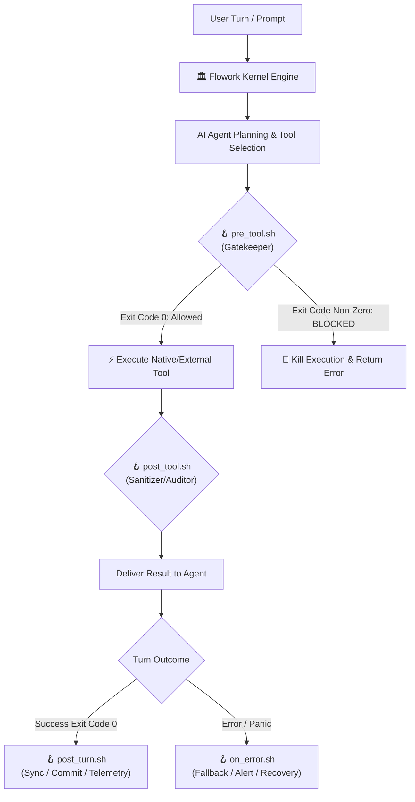

# 🪝 Flowork OS Lifecycle Hooks & Safety Interceptors

The **Hooks** subsystem in Flowork OS provides deterministic, out-of-band interception points across the AI agent's execution lifecycle. Unlike prompt instructions or sensory triggers that merely advise the language model, **Hooks act as mechanical circuit breakers, security gatekeepers, and automated post-processors directly at the OS level**.

---

## 🏛️ Architecture: Why Hooks Matter

In an autonomous agent operating on local hardware, relying solely on language model compliance creates non-deterministic vulnerabilities. A language model might hallucinate, be influenced by adversarial prompt injections, or misunderstand tool boundaries.

**Hooks solve this at the physical execution pipeline**:



---

## 📋 The Five Canonical Hook Interception Points

| Hook Script | Trigger Timing | Primary Responsibility | Input Payload (`$1` / stdin) | Exit Code Contract |
|---|---|---|---|---|
| **`pre_tool.sh`** | Immediately **before** tool process spawn | Command validation, destructive command blocking, rate limiting | JSON string: `{"tool": "<name>", "args": {...}}` | `0` = Allow<br/>`!= 0` = Abort & return stderr |
| **`post_tool.sh`** | Immediately **after** tool execution | Data masking, API secret redaction, output formatting | JSON string: `{"tool": "<name>", "output": "..."}` | `0` = Proceed |
| **`post_turn.sh`** | Upon successful completion of an agent turn | Git auto-commit, telemetry sync, workspace state archiving | Session ID / metadata string | `0` = Success |
| **`on_error.sh`** | When an unrecoverable turn or engine error occurs | Emergency daemon restart, fallback model dispatch, alert webhook | Error message / stack trace string | `0` = Acknowledged |
| **`block-dangerous-git.sh`** | Pre-tool terminal filter | Intercepts destructive git commands (`push --force`, `reset --hard`, `clean -fd`, `branch -D`) | Raw command or JSON payload | `0` = Safe<br/>`2` = Denied |

---

## 🛠️ How to Create & Author a Custom Hook

Every hook in Flowork OS is an executable script (POSIX Bash `.sh` or Node.js `.mjs`) located in `{engine_root}/hooks/`.

### 1. The Pre-Tool Security Guard Hook (`pre_tool.sh`)
This hook is executed prior to launching any tool. If the script exits with any status other than `0`, the tool is immediately rejected without spawning the actual command.

```bash
#!/usr/bin/env bash
# [FLOWORKOS:HOOK] Pre-Tool Interceptor
set -euo pipefail

PAYLOAD="${1:-}"

# Example: Guard against unauthorized file deletions or disk wipes
if echo "$PAYLOAD" | grep -qE "(rm[[:space:]]+-rf[[:space:]]+/|mkfs|dd[[:space:]]+if=)"; then
  echo "🛑 BLOCKED by pre_tool: Destructive disk-wipe command detected!" >&2
  exit 2
fi

# Example: Integrate Git Guardrails
if echo "$PAYLOAD" | grep -qi "git "; then
  SCRIPT_DIR="$(cd "$(dirname "${BASH_SOURCE[0]}")" && pwd)"
  if [[ -f "$SCRIPT_DIR/block-dangerous-git.sh" ]]; then
    "$SCRIPT_DIR/block-dangerous-git.sh" "$PAYLOAD"
  fi
fi

exit 0
```

### 2. The Post-Tool Data Redaction Hook (`post_tool.sh`)
This hook intercepts tool results before they are delivered to the model context. Use it to redact secrets, tokens, or personal identifiers.

```bash
#!/usr/bin/env bash
# [FLOWORKOS:HOOK] Post-Tool Interceptor
set -euo pipefail

RAW_OUTPUT="${1:-}"

# Redact OpenAI, GitHub, and generic API keys from tool outputs
SANITIZED=$(echo "$RAW_OUTPUT" | sed -E \
  -e 's/sk-[a-zA-Z0-9_-]{20,}/[REDACTED_API_KEY]/g' \
  -e 's/ghp_[a-zA-Z0-9]{20,}/[REDACTED_GITHUB_TOKEN]/g')

echo "$SANITIZED"
exit 0
```

### 3. The Post-Turn Auto-Commit Hook (`post_turn.sh`)
Executed whenever a turn finishes with status `SUCCESS`:

```bash
#!/usr/bin/env bash
# [FLOWORKOS:HOOK] Post-Turn Interceptor
SESSION_ID="${1:-unknown}"

# Example: Automatically log telemetry or trigger light workspace sync
echo "[$(date -u +%FT%TZ)] Turn completed for session: $SESSION_ID" >> .flowork_spam/turn_telemetry.log
exit 0
```

### 4. The On-Error Alert Hook (`on_error.sh`)
Executed whenever an agent task panics or fails to achieve exit code 0:

```bash
#!/usr/bin/env bash
# [FLOWORKOS:HOOK] On-Error Interceptor
ERROR_DETAILS="${1:-unknown error}"

echo "[CRITICAL AGENT ERROR] $ERROR_DETAILS" >&2
# Example: Send webhook alert or notify administrator
exit 0
```

---

## 🔒 The Exit Code Contract

Hooks must adhere strictly to standard UNIX exit codes:
* **Exit Code `0` (`SUCCESS`)**:
  Operation is verified and approved. The engine proceeds to the next stage immediately.
* **Exit Code `2` (`PERMISSION_DENIED / BLOCKED`)**:
  Operation is mechanically aborted. The stderr output from the hook is wrapped in an error response and returned to the agent without executing the underlying command.
* **Exit Code `1` (`GENERAL_FAILURE`)**:
  Hook execution failed internally. The engine logs the failure and falls back according to security policy.

---

## ⚡ Performance Best Practices

1. **Sub-50ms Execution**: Hooks sit directly in the execution path. Avoid slow remote network queries or long disk traversals inside `pre_tool` and `post_tool`.
2. **Idempotency**: Hooks may be called repeatedly; ensure actions (like logging or file touching) do not corrupt system state.
3. **No Interactive Prompts**: Hooks execute headlessly. Never call `read` without a timeout or terminal TTY verification.
