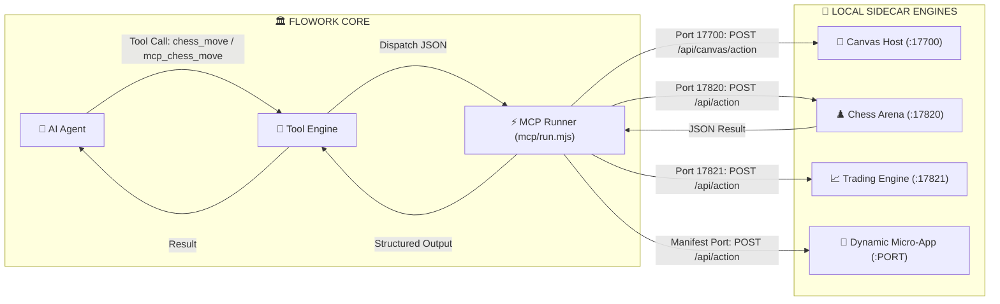

# 🔌 Flowork OS Model Context Protocol (MCP) & Nano-Tool Runner

The **Model Context Protocol (MCP)** subsystem in Flowork OS provides an open, standardized bridge between the sovereign AI Agent (Mr. Flow) and external sidecar micro-apps, Canvas interactive stages, and third-party tool servers.

Rather than coupling complex application logic directly into the immutable micro-kernel, Flowork delegates graphical and domain-specific execution to lightweight, local micro-services over standard IPC/HTTP channels.

---

## 🏛️ Architecture: How MCP Works in Flowork

Flowork's MCP architecture consists of three interconnected layers:
1. **The Kernel Bridge (`core/src/tools.rs`)**: Normalizes tool calls with the `mcp_` prefix and enforces domain and role cluster permissions.
2. **The Universal MCP Nano-Tool Runner (`mcp/run.mjs`)**: Resolves target ports dynamically and dispatches structured JSON payloads to running sidecars.
3. **The Micro-App Sidecar Engine**: A lightweight local HTTP/IPC server running on loopback (`127.0.0.1`) that executes domain logic and returns JSON results.



---

## 📍 Port Resolution Strategy

The Universal MCP Runner (`mcp/run.mjs`) determines the target port using a two-tier resolution strategy:

### 1. Well-Known Environment & Default Port Map
For core system sidecars, ports are mapped by tool prefix:

| Tool Prefix | Target Subsystem | Environment Variable | Default Port |
|---|---|---|---|
| `chess_*` | Chess Arena Micro-App | `FLOWORK_CHESS_PORT` | `17820` |
| `trade_*` | Quantitative Trading Engine | `FLOWORK_TRADING_PORT` | `17821` |
| `website_intel_*` / `intel_*` | Web Intelligence Scraper | `FLOWORK_WEBINTEL_PORT` | `17822` |
| `youtube_*` | Audio/Video Media Studio | `FLOWORK_YOUTUBE_PORT` | `17823` |
| `websec_*` | Web Security Scanner | `FLOWORK_WEBSEC_PORT` | `17824` |
| `canvas_control` | Canvas Stage Supervisor | `FLOWORK_SIDECAR_HOST_PORT` | `17700` |

### 2. Dynamic Discovery via `app.manifest.json`
For custom or third-party applications placed in `{engine_root}/apps/<app_id>/`:
* The runner scans `apps/<app_id>/app.manifest.json`.
* If the tool name matches `<app_id>_<action>` or `flow_<app_id>_<action>`, it reads `manifest.ipc.default_port`.

---

## 🚀 How to Create an MCP-Compatible Micro-App

Building a new tool service that can be driven by the AI agent via MCP requires only three simple steps:

### Step 1: Declare the Manifest (`apps/<my_app>/app.manifest.json`)
```json
{
  "id": "my_app",
  "name": "My Custom Micro-App",
  "version": "1.0.0",
  "ipc": {
    "default_port": 17830,
    "endpoints": {
      "action": "/api/action"
    }
  }
}
```

### Step 2: Implement the Local Action Server (`apps/<my_app>/server.mjs`)
The sidecar server must listen on `127.0.0.1` and accept `POST /api/action`:

```javascript
import http from 'node:http';

const PORT = 17830;

const server = http.createServer((req, res) => {
  if (req.method === 'POST' && req.url === '/api/action') {
    let body = '';
    req.on('data', chunk => body += chunk);
    req.on('end', () => {
      try {
        const { action, payload, source } = JSON.parse(body);
        
        // Handle domain-specific actions
        if (action === 'my_app_calculate') {
          const result = { sum: (payload.a || 0) + (payload.b || 0) };
          res.writeHead(200, { 'Content-Type': 'application/json' });
          return res.end(JSON.stringify({ status: 'SUCCESS', result }));
        }

        res.writeHead(400, { 'Content-Type': 'application/json' });
        res.end(JSON.stringify({ error: `Unknown action: ${action}` }));
      } catch (err) {
        res.writeHead(500, { 'Content-Type': 'application/json' });
        res.end(JSON.stringify({ error: err.message }));
      }
    });
  } else {
    res.writeHead(404);
    res.end();
  }
});

server.listen(PORT, '127.0.0.1', () => {
  console.log(`[my_app] MCP Sidecar active on http://127.0.0.1:${PORT}`);
});
```

### Step 3: Execute via the MCP Runner
Once your sidecar is running, either call it directly from the terminal or let the AI Agent invoke it:

```bash
# Direct terminal execution
node mcp/run.mjs my_app_calculate '{"a": 15, "b": 27}'

# Expected output:
# { "status": "SUCCESS", "result": { "sum": 42 } }
```

---

## 🔒 Security & Loopback Isolation

1. **Strict Localhost Binding**: All MCP servers MUST bind exclusively to `127.0.0.1` (loopback). Never bind to `0.0.0.0` or expose open network ports to external interfaces.
2. **5-Second Timeout Guard**: The runner enforces a strict 5000ms HTTP timeout on all action requests to prevent hanging sidecars from stalling the agent.
3. **Structured Payload Validation**: Payloads are validated against JSON schemas before dispatch.
