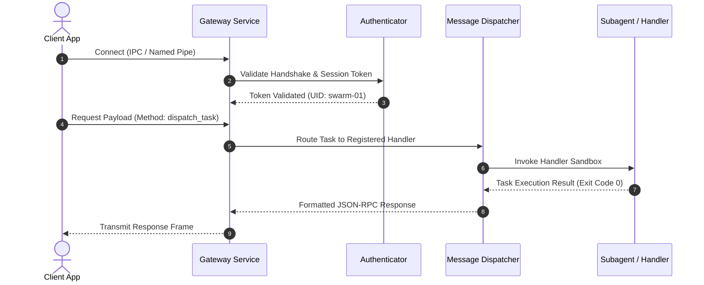

# Data Flow Sequence Blueprint

## 1. Primary Request-Response Sequence

## 2. Failure & Circuit Breaker Sequence
1. **Invalid Token:** Authenticator responds with `401 Unauthorized`; connection drops immediately.
2. **Worker Panic / Timeout:** Dispatcher intercepts panic, isolates failure, increments error circuit breaker, and returns `504 Gateway Timeout` with zero process crash.
