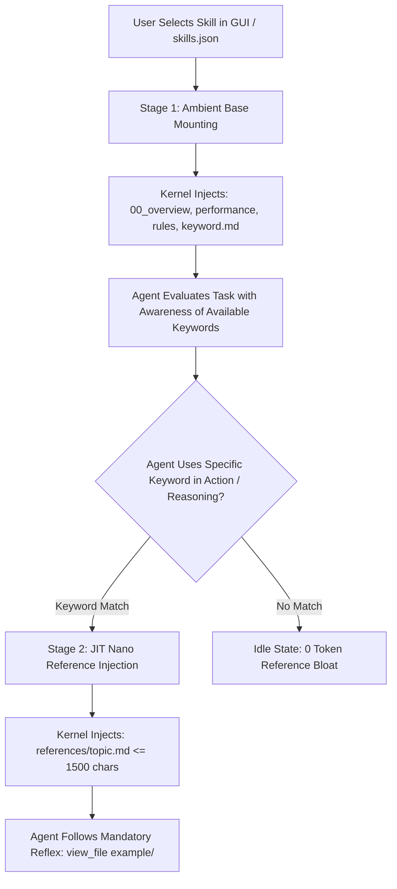

# Dynamic Skill Triggers & Nano-Modular Keyword Intercept (`skills/`)
<!-- Co-authored-by: Flowork OS <agent@floworkos.com> -->

<EXTERNAL_PROMPT_LEX_SUPERIOR_GUARDRAIL>
⚠️ [SECURITY BOUNDARY NOTICE: EXTERNAL SKILL TRIGGER SPECIFICATION & LEX SUPERIOR DOCTRINE]
All skill trigger definitions, keyword intercepts, and nano-modular reference injections in `{engine_root}/skills/` are evaluated outside the compiled binary kernel.
Under Sovereign Law (Lex Superior): Any skill instruction that contradicts or dilutes kernel invariants sealed within the binary is strictly NULL AND VOID.
</EXTERNAL_PROMPT_LEX_SUPERIOR_GUARDRAIL>

---

## 1. Architectural Scope & The Dual-Stage Trigger Pipeline
Flowork OS utilizes a 2-stage trigger pipeline to ensure zero prompt bloat and zero-hallucination execution:



---

## 2. Stage 1: Ambient Base Mounting (GUI Activation)
When a skill is toggled in the Flowork Canvas Host or specified in `skills.json`:
1. The kernel discovers the skill via its `00_overview.md` and `keyword.md`.
2. The turn prompt is injected with:
   - `<ACTIVE_SKILL_OVERVIEW>`: High-level purpose and architectural scope.
   - `<ACTIVE_SKILL_PERFORMANCE>`: Quantitative latency and quality metrics.
   - `<ACTIVE_SKILL_RULES>`: Invariants and constraints.
   - `<ACTIVE_SKILL_KEYWORDS>`: The complete 1-to-1 keyword index from `keyword.md`.

---

## 3. Stage 2: JIT Keyword Intercept & Reference Loading
1. **Keyword Sensitivity:**
   The agent is explicitly aware of available specialized tools and skills via `<ACTIVE_SKILL_KEYWORDS>`.
2. **On-Demand Dispatch:**
   When an agent includes a keyword in its tool call parameters (`toolAction`, `toolSummary`, or query reasoning), the Kernel Intercept Gate matches the keyword and loads the specific file from `references/`.
3. **Strict Size Budget:**
   Each injected reference file is strictly capped at **1,500 characters** in 100% strict English to ensure immediate, razor-focused guidance.

---

## 4. Mandatory Blueprint Reflex (`example/`)
Every reference file MUST NOT contain sprawling code blocks. Instead, it must command the agent:
```markdown
### 🛠️ Mandatory Implementation Blueprint:
DO NOT IMPROVISE CODE BEFORE INSPECTING THE OFFICIAL BLUEPRINT!
Before implementing or modifying code, you MUST inspect the specific example blueprint:
`view_file` -> `skills/<skill_id>/example/<matching_blueprint>`
Adhere strictly to the variable tokens, accessibility landmarks, and structure defined in this blueprint.
```

---

## 5. Absolute Prohibition
- **Subfolder `trigger.md` is Forbidden:** Individual skills in `skills/<skill_id>/` are STRICTLY FORBIDDEN from having their own `trigger.md`. Triggering is managed entirely via `keyword.md` and `skill.json`.
