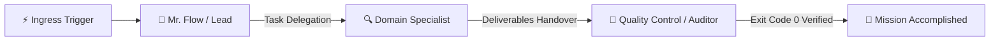

<!-- [FL_INDEX: keywords="swarmflow, dag_pipeline, subagent_orchestration, node_schema, separation_of_concerns" | purpose="Authoritative specification and creation runbook for Swarm Flow presets, nodes, and connections"] -->
# ⚡ Flowork OS — Swarm Flow Orchestration Engine

> **Module Directory**: `swarmflow/`  
> **Sovereign Principles**: 1 Preset = 1 Atomic JSON File, Multi-OS Agnostic (Zero-Hardcode Paths), 1 Agent 1 Task (Strict Separation of Concerns), Boundless Multi-Domain Intelligence.

---

## 1. What is Swarm Flow?

**Swarm Flow** is the autonomous multi-agent swarm orchestration engine built on Directed Acyclic Graph (DAG) architecture within Flowork OS. It coordinates autonomous specialist subagents into synchronized execution relays, enabling complex multi-stage objectives to run seamlessly from trigger ingress to verified completion.

### 🌐 Universal Multi-Domain Intelligence (Beyond Code)
Flowork OS rejects the narrow assumption that AI multi-agent swarms are strictly for software engineering. Swarm Flow is designed from first principles as an **All-Domain Autonomous Framework**:
- **📈 Forex & Quant Finance**: Real-time market tick sensors, Quantitative VaR calculation, Capital Preservation Risk audits, and autonomous order dispatching.
- **⚖️ Corporate Law & Contract Auditing**: Automated clause scrutiny, hidden liability and indemnity detection, counter-redline generation, and Senior Partner sign-off.
- **🧠 Psychology & Consultation**: Empathetic client triage and intake, cognitive reframing coaching, somatic homework management, and immediate crisis de-escalation routing.
- **🚀 SEO & Growth Marketing**: Chrono SERP rank auditing, semantic keyword clustering, technical crawl forensics, JSON-LD schema generation, and EEAT information gain architecture.
- **🎬 Creative Media & YouTube**: Trend intelligence, competitor retention forensics, high-CTR hook writing, voice synthesis, multi-track audio mastering, and automated FFmpeg video assembly.
- **💻 Software Systems & DevOps**: Architecture governance by Mr. Flow / Lead, backend microservices, responsive glassmorphic frontend UI, penetration testing by Security, and regression validation by Quality Control.

---

## 2. Cardinal Architectural Laws

### Law 1: 1 Preset = 1 Atomic JSON File
- Every preset is an isolated, self-contained JSON file residing in `swarmflow/{preset_id}.json`.
- The active preset is tracked exclusively by `swarmflow/active.json`.
- Paths MUST be dynamically resolved (`resolve_engine_root().join("swarmflow")`). **Zero hardcoded absolute paths** (`/home/...`, `C:\...`).

### Law 2: 1 Agent = 1 Task (Strict Separation of Concerns)
- **Zero God-Agents**: Never overload an agent with conflicting, disparate, or multiple responsibilities.
- Each specialist subagent in `system/subagent/{agent_id}` represents **exactly one distinct domain task** (e.g., SEO Forensics, UI Overlay, Voice Synthesis, Security Audit).
- A writer agent does NOT audit its own work; an execution worker does NOT act as its own Quality Control. The pipeline enforces clean relay handovers between distinct nodes.

### Law 3: Sacred Node Header Contract (Anti-Undefined Doctrine)
- The Canvas UI DAG card header renders:
  ```javascript
  <span>${node.role || node.name || node.title || node.id || 'Specialist Agent'}</span>
  ```
- **Every node MUST define `role` and `name` explicitly.** Omitting `role` violates the visual contract and leads to degraded UI labels or `undefined` states.

---

## 3. Storage & Directory Layout

```text
swarmflow/
├── active.json                 <-- Dynamic pointer identifying the currently active preset
├── default.json                <-- System fallback preset (Ingress -> Lead -> Dev -> QC)
├── seo_growth_pipeline.json    <-- SEO & Web Growth Intelligence Preset
├── stickman_studio_swarm.json  <-- 2D Animation & Stickman Video Studio Preset
└── [custom_preset].json        <-- User-defined domain presets
```

### Pointer File Contract (`swarmflow/active.json`):
```json
{
  "activePresetId": "seo_growth_pipeline",
  "updatedAt": 1793120650000
}
```

---

## 4. Preset Schema Specification (`{preset_id}.json`)

Every preset file MUST adhere to this exact JSON schema:

```json
{
  "id": "seo_growth_pipeline",
  "name": "SEO & Web Growth Swarm Flow",
  "domain": "Growth & Marketing Engineering",
  "description": "Full-cycle automated SEO intelligence swarm: competitive SERP analysis, technical crawl audit, semantic clustering, and EEAT information gain architecture.",
  "icon": "🌐",
  "panX": 40,
  "panY": 40,
  "scale": 1.0,
  "nodes": [
    {
      "id": "trigger_input",
      "type": "trigger",
      "name": "Audit Dispatch Trigger",
      "role": "Search Query & URL Ingress",
      "avatar": "⚡",
      "category": "trigger",
      "instruction": "Receives target domain URL and seed keywords for comprehensive technical search engine evaluation.",
      "x": 80,
      "y": 180,
      "width": 240,
      "height": 130
    },
    {
      "id": "mrflow_lead",
      "type": "agent",
      "agentId": "mrflow",
      "name": "Mr. Flow",
      "role": "Grand Chief AI Overseer & Lead Strategist",
      "avatar": "⚡",
      "category": "management",
      "instruction": "Directs SEO campaign strategy, scopes technical crawl parameters, and synthesizes SERP intelligence into actionable growth roadmaps.",
      "x": 380,
      "y": 180,
      "width": 250,
      "height": 130
    },
    {
      "id": "seo_specialist",
      "type": "agent",
      "agentId": "seo-web-intelligence",
      "name": "SEO & Web Intelligence Specialist",
      "role": "Technical SEO & Search Engine Forensics Specialist",
      "avatar": "🔍",
      "category": "growth",
      "instruction": "Executes on-page DOM inspection, Core Web Vitals profiling, semantic clustering, JSON-LD schema generation, and SERP forensics.",
      "x": 700,
      "y": 180,
      "width": 260,
      "height": 130
    }
  ],
  "connections": [
    {
      "id": "conn_trig_lead",
      "from": "trigger_input",
      "to": "mrflow_lead",
      "label": "Audit Parameters & Target Domain",
      "guardianEnabled": true
    },
    {
      "id": "conn_lead_seo",
      "from": "mrflow_lead",
      "to": "seo_specialist",
      "label": "Strategic Scope & Tactical Delegation",
      "guardianEnabled": true
    }
  ],
  "updatedAt": 1793120650000
}
```

### Complete Field Reference

#### A. Preset Root Object:
| Field | Type | Required | Description |
| :--- | :--- | :--- | :--- |
| `id` | `string` | **Yes** | Slug identifier matching filename (`{id}.json`). |
| `name` | `string` | **Yes** | Human-readable title displayed in preset dropdown. |
| `domain` | `string` | **Yes** | Industry or technical domain classification. |
| `description`| `string` | **Yes** | Clear architectural summary of the swarm's objective. |
| `icon` | `string` | **Yes** | Emoji icon representing the domain (e.g. `🌐`, `🎬`, `📈`). |
| `panX`, `panY`| `number` | No | Canvas default camera offset (default: `40`). |
| `scale` | `number` | No | Canvas default zoom level (default: `1.0`). |
| `nodes` | `array` | **Yes** | List of node objects (see below). |
| `connections`| `array` | **Yes** | List of connection cable objects (see below). |
| `updatedAt` | `number` | No | Unix timestamp in milliseconds. |

#### B. Node Object (`nodes[]`):
| Field | Type | Required | Description |
| :--- | :--- | :--- | :--- |
| `id` | `string` | **Yes** | Unique node ID within the preset (e.g. `node-seo-worker`). |
| `type` | `string` | **Yes** | Node kind: `"trigger"`, `"agent"`, or `"transformer"`. |
| `agentId` | `string` | **Mandatory for agent** | **Exact directory name in `system/subagent/{agentId}`**. Links the node to its sovereign persona, rules, and skills. |
| `name` | `string` | **Yes** | Human-readable name (e.g. `"SEO Specialist"`). |
| `role` | `string` | **MANDATORY** | **Primary title rendered in the DAG card header.** (e.g. `"Technical SEO & Forensics Specialist"`). Prevents `undefined` rendering. |
| `avatar` | `string` | **Yes** | Emoji icon displayed on node card (e.g. `🔍`, `⚡`, `🧪`). |
| `category` | `string` | **Yes** | Category slug (`trigger`, `management`, `growth`, `security`, `frontend`, `qc`, etc.). |
| `instruction`| `string` | **Yes** | Actionable single-task directive assigned to this node in the relay chain. |
| `x`, `y` | `number` | **Yes** | Canvas grid coordinates (recommended step: +300–320px along X axis). |
| `width` | `number` | **Yes** | Node card width (typically `240` to `260`). |
| `height` | `number` | **Yes** | Node card height (typically `120` to `140`). |

#### C. Connection Object (`connections[]`):
| Field | Type | Required | Description |
| :--- | :--- | :--- | :--- |
| `id` | `string` | **Yes** | Unique connection ID (e.g. `conn_lead_to_worker`). |
| `from` | `string` | **Yes** | Source node `id`. |
| `to` | `string` | **Yes** | Target destination node `id`. |
| `label` | `string` | No | Semantic description of data, task, or artifact handed over. |
| `guardianEnabled`| `boolean`| No | If `true`, requires downstream validation gate before relay fires. |

---

## 5. How Swarm Flow Works (Autonomous Sequential Relay)

Swarm Flow executes multi-agent workflows through an uninterrupted relay chain:



1. **Native Context Injection (`<ACTIVE_SWARM_PIPELINE>`)**:
   - The Rust kernel reads `swarmflow/active.json`, extracts the active preset, and injects the topology directly into the agent context window at session start.
   - The agent immediately knows the active domain, fellow squad members, upstream trigger inputs, and downstream handover rules without executing manual filesystem reads.
2. **Autonomous Sequential Relay**:
   - When an upstream specialist finishes its duty, it hands off structured output to the downstream node.
   - The relay continues until the terminal verification node (QC / Security Auditor) confirms zero errors (**Exit Code 0**).
3. **3D Virtual Office Synchronization**:
   - The 3D Virtual Office reads the active preset and **renders only the avatars and workstations belonging to the active squad**.
   - If 30 subagents exist in `system/subagent/`, the 3D room remains clean, rendering only the active 3–5 specialists.

---

## 6. Runbook: How to Create a New Swarm Flow (AI Agent Standard)

When tasked to create a new Swarm Flow preset, follow this deterministic checklist:

### Step 1: Subagent Verification & Scaffolding
- Check `system/subagent/` for existing agents matching each task.
- If a required specialist does not exist, create it following the Sovereign Subagent standard:
  ```text
  system/subagent/{agent_id}/
  ├── agent.json    <-- Manifest (id, name, role, category, avatar, skills)
  ├── persona.md    <-- Identity, worldview, tone, and cognitive archetype
  ├── rules.md      <-- Strict operational boundaries and negative constraints
  ├── task.md       <-- Concrete deliverables and single-task contract
  └── style.json    <-- Visual theme and avatar styling
  ```
- **Rule of Thumb**: 1 subagent directory = 1 domain role. Never bundle unrelated tasks together.

### Step 2: Preset File Authoring
- Create `swarmflow/{preset_id}.json`.
- Populate every node with:
  - `id`: unique string
  - `type`: `"trigger"` or `"agent"`
  - `agentId`: matching subagent directory name (for `"agent"`)
  - `name`: Human-readable name
  - **`role`**: Descriptive role title (MUST NOT BE EMPTY)
  - `avatar`: Contextual emoji
  - `category`: Classification
  - `instruction`: Single-task directive
  - Coordinates: `x`, `y`, `width`, `height`
- Populate `connections` linking Ingress -> Lead -> Specialist(s) -> QC.

### Step 3: Registration & Dual-Sync Mandate
- Register the preset as active in `swarmflow/active.json`:
  ```json
  {
    "activePresetId": "{preset_id}",
    "updatedAt": 1793120650000
  }
  ```
- Synchronize `system/pipeline_dag.json` with the new nodes and connections so that both the backend daemon and the Canvas UI reflect the active graph immediately.

### Step 4: Verification Gate (QC Before Done)
- Verify JSON syntax: `python3 -m json.tool swarmflow/{preset_id}.json > /dev/null`.
- Query runtime endpoint: `http://127.0.0.1:19890/api/swarmflow/active` to verify that all nodes return with non-null `name` and `role`.
- Run `audit_security` to verify zero path leaks or security regressions.
- Ensure terminal output reports **Exit Code 0**.

---

## 7. Common Anti-Patterns & Post-Mortem Traps

| Anti-Pattern | Root Cause | Impact | Remedy |
| :--- | :--- | :--- | :--- |
| **`undefined` on DAG card header** | Node JSON omitted the `role` attribute. | Card header displayed `undefined` in Canvas UI. | Always specify `role` on every node in `nodes[]`. |
| **Orphaned Node in Cockpit** | Missing or incorrect `agentId` in `nodes[]`. | Cockpit modal cannot resolve agent persona/rules from `system/subagent/`. | Set `agentId` to match the exact subagent folder name. |
| **God-Agent Anti-Pattern** | 1 agent assigned multiple distinct roles (e.g. writing + auditing + coding). | Cognitive overload, conflicting instructions, self-audit blind spots. | Enforce 1 Agent 1 Task. Split into distinct specialist subagents. |
| **Hardcoded Host Paths** | Using `/home/...` or `C:\...` in presets or configs. | Breaks on other machines, violates portability doctrine. | Use engine-relative paths (`swarmflow/{preset_id}.json`). |
| **DAG Desync** | Updating `swarmflow/{preset_id}.json` without updating `system/pipeline_dag.json`. | Canvas UI displays stale DAG state until next full reload. | Always keep `system/pipeline_dag.json` synchronized with the active preset. |
