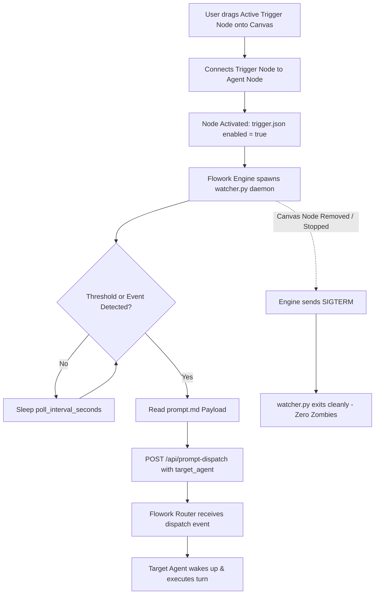

# 📡 Active System Trigger Architecture & Standard Runbook

## 1. Overview & Architectural Philosophy
An **Active Trigger** is a proactive, autonomous watchdog node in Flowork OS.

### Active vs. Passive Trigger Duality
* **Passive Trigger (`system/system_promp/`)**: Quiescent and pull-based. It has zero background process overhead. Evaluated Just-In-Time (JIT) by the native engine exclusively during an agent's turn prompt assembly.
* **Active Trigger (`system/triger/`)**: Autonomous and push-based. It lives visually on the **Flowork GUI Sidebar / Palette** as a canvas component. When dragged onto the canvas and linked to an Agent node, it spins up a persistent background watchdog daemon. It continuously monitors external state (e.g. crypto market tickers, webhook receivers, hardware signals, or cron ticks) and **proactively injects a prompt payload to wake up the connected agent** as soon as target thresholds are met.

---

## 2. Standard Directory Structure
Every active trigger resides inside its own dedicated subfolder under `system/triger/`:

```text
system/triger/
├── SKILL.md                 # [RUNBOOK] Authoritative Architecture Standard
├── bitcoin_threshold/       # [ACTIVE TRIGGER EXAMPLE: Market Monitor]
│   ├── trigger.json         # [PILLAR 1: Node Config, Switch, Canvas Icon, Target Agent]
│   ├── watcher.py           # [PILLAR 2: Persistent Watcher Daemon Script]
│   └── prompt.md            # [PILLAR 3: Prompt Payload Dispatched to Wake Up Agent]
└── webhook_receiver/        # [ACTIVE TRIGGER EXAMPLE: Webhook Event]
    ├── trigger.json         # Configuration & target agent binding
    ├── watcher.py           # HTTP/WebSocket listener daemon
    └── prompt.md            # Event notification prompt payload
```

---

## 3. Pillar Specifications

### 3.1 Pillar 1: Declarative Trigger Configuration (`trigger.json`)
The manifest and configuration file defining the trigger's canvas appearance, state, parameters, and target agent.

```json
{
  "id": "bitcoin_threshold",
  "name": "Bitcoin Threshold Watcher",
  "enabled": true,
  "canvas": {
    "icon": "currency-bitcoin",
    "color": "#f7931a",
    "category": "market_watcher"
  },
  "target_agent": "crypto-analyst",
  "config": {
    "target_price_usd": 100000,
    "poll_interval_seconds": 30
  }
}
```

#### Field Contract:
* `id` *(string, mandatory)*: Unique snake_case identifier matching the directory name.
* `name` *(string, mandatory)*: Human-readable display label on the canvas node.
* `enabled` *(boolean, mandatory)*: Master switch. Set to `true` when node is activated on canvas.
* `canvas` *(object, optional)*: Visual presentation metadata for the GUI canvas (icon name, accent color, category).
* `target_agent` *(string, mandatory)*: The ID or role of the agent node connected to receive the wakeup event.
* `config` *(object, optional)*: User-tunable parameters (thresholds, URLs, polling intervals).

---

### 3.2 Pillar 2: Watcher Daemon Script (`watcher.py` / `watcher.mjs`)
The standalone executable process that monitors external signals.
* **Persistent Execution**: Spawns when the trigger node is connected and enabled on the canvas.
* **Autonomous Triggering**: Continuously evaluates target conditions against real-world metrics.
* **Prompt Injection**: When the condition is met (e.g. price >= target), it dispatches the contents of `prompt.md` into the agent session via the Flowork IPC / HTTP endpoint (`POST /api/prompt-dispatch` or `/api/chat/message`).
* **Clean Termination**: Must trap `SIGTERM` and `SIGINT` to ensure immediate and clean exit without leaving dangling zombie processes.

---

### 3.3 Pillar 3: Prompt Payload (`prompt.md`)
The markdown instruction dispatched to the target agent when the condition fires. Written in 100% strict English.

```markdown
# 🚨 Bitcoin Target Threshold Breached

The Bitcoin (BTC/USDT) market price has crossed the specified target threshold of **$100,000**.

### Operational Directives:
1. Immediately review current open positions and risk exposure.
2. Execute portfolio take-profit or hedge routines according to the active strategy.
3. Provide an executive summary of market momentum and liquidity to the user.
```

---

## 4. How to Create a New Active Trigger (Step-by-Step)

### Step 1: Create the Trigger Directory
Create a folder under `system/triger/<trigger_name>`:
```bash
mkdir -p system/triger/bitcoin_threshold
```

### Step 2: Author `trigger.json`
Define the node parameters, canvas icon, and connected target agent:
```json
{
  "id": "bitcoin_threshold",
  "name": "Bitcoin Threshold Watcher",
  "enabled": true,
  "canvas": {
    "icon": "currency-bitcoin",
    "color": "#f7931a"
  },
  "target_agent": "crypto-analyst",
  "config": {
    "target_price_usd": 100000,
    "poll_interval_seconds": 30
  }
}
```

### Step 3: Author `watcher.py`
Implement the monitoring daemon with signal handling and prompt dispatch:

```python
#!/usr/bin/env python3
import os
import sys
import time
import json
import signal
import urllib.request

# Configuration
CORE_URL = os.environ.get("FLOWORK_CORE_URL", "http://127.0.0.1:19890")
CONFIG_PATH = os.path.join(os.path.dirname(__file__), "trigger.json")
PROMPT_PATH = os.path.join(os.path.dirname(__file__), "prompt.md")

running = True

def handle_shutdown(signum, frame):
    global running
    running = False
    sys.exit(0)

signal.signal(signal.SIGTERM, handle_shutdown)
signal.signal(signal.SIGINT, handle_shutdown)

def load_config():
    with open(CONFIG_PATH, "r") as f:
        return json.load(f)

def load_prompt():
    with open(PROMPT_PATH, "r") as f:
        return f.read()

def dispatch_to_agent(target_agent, prompt_text):
    payload = {
        "trigger_id": "bitcoin_threshold",
        "to_agent": target_agent,
        "prompt": prompt_text
    }
    req = urllib.request.Request(
        f"{CORE_URL}/api/prompt-dispatch",
        data=json.dumps(payload).encode("utf-8"),
        headers={"Content-Type": "application/json"}
    )
    urllib.request.urlopen(req, timeout=5)

def main():
    config = load_config()
    target_price = config.get("config", {}).get("target_price_usd", 100000)
    target_agent = config.get("target_agent", "crypto-analyst")
    interval = config.get("config", {}).get("poll_interval_seconds", 30)
    prompt_text = load_prompt()

    while running:
        try:
            # Probe external data source (example: market ticker API)
            # In production, query live market feed
            current_price = 100250.0  # Simulated price probe

            if current_price >= target_price:
                dispatch_to_agent(target_agent, prompt_text)
                break  # Or enter cool-down period
        except Exception as e:
            sys.stderr.write(f"Watcher probe error: {e}\n")

        time.sleep(interval)

if __name__ == "__main__":
    main()
```

### Step 4: Author `prompt.md`
Write the precise prompt instruction to wake up the agent when triggered.

---

## 5. Execution & Lifecycle Flow



---

## 6. Standard Invariants & Quality Rules
1. **Targeted Wakeup**: An active trigger does not passively wait for the user to chat. It proactively wakes up the designated `target_agent`.
2. **Strict English**: All `prompt.md` files and documentation MUST be written in 100% strict English.
3. **Graceful Shutdown**: The watcher daemon MUST intercept `SIGTERM` and `SIGINT` to exit cleanly. Dangling or zombie background processes are strictly prohibited.
4. **Portability**: Never hardcode absolute system paths. Always use relative directory lookups (`os.path.dirname(__file__)` or relative paths) and environment variables (`FLOWORK_CORE_URL`).
5. **Decoupled Architecture**: Configuration lives in `trigger.json`, daemon logic lives in `watcher.py`, and prompt prose lives in `prompt.md`.
